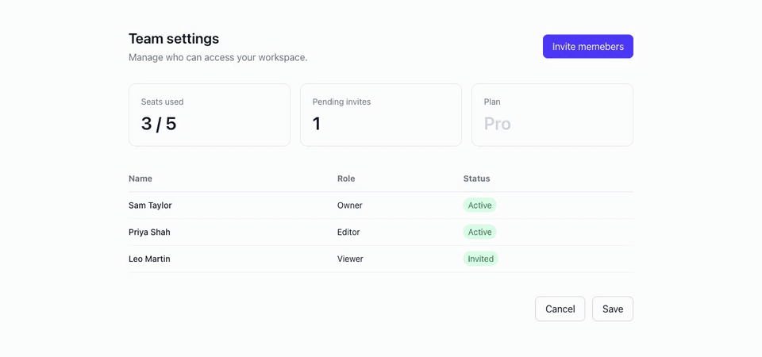

<p align="center">
  <picture>
    <source media="(prefers-color-scheme: dark)" srcset="assets/brand/pinpoint-lockup-endorsed-reversed.svg">
    
  </picture>
</p>

# Pinpoint

**Bug reports pinned to the exact element.**

Pinpoint is a side drawer for reviewing a web app while it runs. A reviewer clicks the button in the corner, points at the thing that's wrong, says what's wrong, and optionally adds a screenshot. The report is saved with the page and the exact element it's about. Anyone can click it later to jump straight to that element, outlined on the page.

<p align="center">
  
</p>

It's built for the team reviewing an app (designers, QA, product, clients on a staging link), not for end users.

---

## Try it

Needs Node.js 20 or later.

```bash
git clone https://github.com/Pilotree-ai/pinpoint.git
cd pinpoint
npm install
npm run dev          # http://localhost:3050
```

Open the home page and go to the **demo page**. It has a few deliberate mistakes to report.

---

## Why it exists

QA feedback on a web app usually looks like this:

- **"The button on the settings page is wrong."** Which button? Which settings page? At which screen size?
- **Screenshots in a chat thread,** cropped so tightly you can't tell where they came from, forty messages above the one you're reading.
- **A ticket per typo.** Filing a proper bug for a misaligned label takes longer than fixing it, so it never gets filed.

Pinpoint keeps the feedback on the page it's about. Every report knows its page and its element, so nobody has to describe where the problem is.

---

## How it works

1. **Say who you are.** The first time you open any page other than `/`, Pinpoint asks for your name. It's kept in your browser and attached to every report you file.
2. **Open the drawer.** Click the round button in the bottom-right corner.
3. **Point at the problem (optional).** Click **Inspect Element**, move over the page (elements are outlined as you go), and click the one that's wrong. Skip this for a general comment about the page.
4. **Describe it.** Type what's wrong, attach a screenshot with the paperclip if it helps, and click **Save Comment**.
5. **Review.** **Recent Feedback** lists every report for the current page, newest first. Click one tied to an element to scroll to it and outline it with a red dashed box.

---

## Add it to your own Next.js app

Pinpoint is a handful of files. Copy them in:

| Copy | To |
|---|---|
| `src/components/Inspector/` | the same path in your app |
| `src/app/actions/comments.ts` | `src/app/actions/` |
| `src/app/api/comments`, `src/app/api/upload`, `src/app/api/visitors` | `src/app/api/` |
| `src/lib/db.ts` | `src/lib/` |

Then:

1. `npm install better-sqlite3` (and `@types/better-sqlite3` for TypeScript), and add `serverExternalPackages: ["better-sqlite3"]` to `next.config.ts`.
2. Wrap your root layout:

   ```tsx
   import { InspectorProvider } from "@/components/Inspector/InspectorProvider";
   import InspectorLayoutWrapper from "@/components/Inspector/InspectorLayoutWrapper";

   <InspectorProvider>
     <InspectorLayoutWrapper>{children}</InspectorLayoutWrapper>
   </InspectorProvider>
   ```

3. Pinpoint uses Tailwind CSS v4 classes. Add the `brand-600`, `primary` and `slide-in-right` tokens from [`src/app/globals.css`](src/app/globals.css) to your theme.
4. Pages should scroll inside `#inspector-scroll-container` (the wrapper creates it), not `window`, so highlights line up.

---

## Turning it on and off

| `NEXT_PUBLIC_ENABLE_INSPECTOR` | Pinpoint is |
|---|---|
| not set | On in development (`npm run dev`), off in production builds |
| `true` | On everywhere. Use this for staging and review deployments |
| `false` | Off everywhere |

The value is read at build time, so changing it needs a rebuild. When Pinpoint is off, the page layout stays the same and only the button, drawer, overlays and name prompt are removed.

---

## Where reports are stored

In a local SQLite file, `data.db` (set `PINPOINT_DB_PATH` to move it). The tables are created on first use. Screenshots are saved to `public/uploads/comments/`.

| Table | One row per |
|---|---|
| `comments` | report: text, reviewer name, page, CSS selector, a readable element label, screenshot path, time |
| `visitors` | time a reviewer enters their name |

`npm run db` prints both tables. `data.db` and `public/uploads/` are in `.gitignore`: they hold your reviewers' names and screenshots, so keep them out of git.

---

## Good to know

- **Highlights use the saved CSS selector.** If the page's structure changes, an old report may no longer find its element. It's still listed, just without the outline.
- **Storage is local.** Reports don't sync between machines, and won't survive on serverless hosts with temporary disks. Run it on a normal server or VM for shared staging.
- **Reviewers aren't authenticated.** The name is whatever someone types. Only switch Pinpoint on for deployments your reviewers can reach and nobody else.
- **Reports can't be edited, resolved or deleted from the drawer yet.**

---

## What's inside

```
src/
  components/Inspector/
    InspectorProvider.tsx       shared state: inspect mode, selection, reviewer, drawer, highlight
    InspectorLayoutWrapper.tsx  page shell: floating button, 400px drawer, name prompt
    InspectorSidebar.tsx        the drawer: inspect toggle, report form, upload, report list
    InspectorLayer.tsx          page overlay: hover outline, element picking, selector, highlight
    NameEntryModal.tsx          first-visit name prompt
    isInspectorEnabled.ts       the on/off flag
  app/
    actions/comments.ts         saveComment and fetchComments, used by the drawer
    api/comments/route.ts       GET all reports, POST one
    api/upload/route.ts         POST a screenshot, returns its URL
    api/visitors/route.ts       POST a reviewer's name
    demo/page.tsx               a sample page to try it on
  lib/db.ts                     SQLite connection and schema
```

---

## More from Pilotree

- **[Vetted](https://github.com/Pilotree-ai/vetted):** one sentence in, an approved, personalised outbound campaign out.
- **[Inboxed](https://github.com/Pilotree-ai/inboxed):** find out if your email lands in the inbox, and get the exact fix.
- **[Recon](https://github.com/Pilotree-ai/recon):** a weekly digest of what your competitors actually changed.
- **[Squawk](https://pilotree.ai/squawk):** find out if AI recommends you.

Built by [Pilotree](https://pilotree.ai). MIT licensed.
